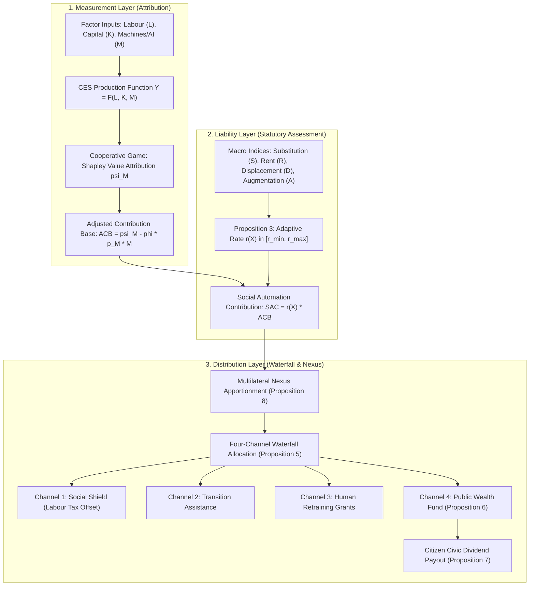

# CivicDividendOS

[](https://github.com/adeliusa486/CivicDividendOS/actions/workflows/ci.yml)
[](https://www.python.org/downloads/release/python-3119/)
[](https://numpy.org/)
[](LICENSE)
[](tests/)
[](#reproducibility--verification)
[](https://github.com/astral-sh/ruff)

**Attribution-based taxation of autonomous economic activity: a framework and computational testbed.**

---

## Table of Contents

- [Research Question & Motivation](#research-question--motivation)
- [Key Theoretical Contributions](#key-theoretical-contributions)
- [System Architecture](#system-architecture)
- [Empirical Status & Audit Disclosure](#empirical-status--audit-disclosure)
  - [Post-Audit Remediation](#post-audit-remediation)
  - [Audit Findings & Remediation Matrix](#audit-findings--remediation-matrix)
  - [Headline Results, Stated Honestly](#headline-results-stated-honestly)
- [Important Scientific & Legal Caveats](#important-scientific--legal-caveats)
  - [Scientific Scope & Methodological Caveats](#scientific-scope--methodological-caveats)
  - [Legal, Tax & Jurisdictional Disclaimers](#legal-tax--jurisdictional-disclaimers)
- [Policy Arms Reference](#policy-arms-reference)
- [Repository Layout](#repository-layout)
- [Installation & Environment Setup](#installation--environment-setup)
  - [Prerequisites & Dependency Pinning](#prerequisites--dependency-pinning)
  - [Option 1: Python Virtual Environment (venv)](#option-1-python-virtual-environment-venv)
  - [Option 2: Conda / Mamba Environment](#option-2-conda--mamba-environment)
  - [Option 3: Docker Container](#option-3-docker-container)
- [Quick Start](#quick-start)
  - [Standard Reproduction Pipeline](#standard-reproduction-pipeline)
  - [Running Single Experiments](#running-single-experiments)
  - [Command-Line Overrides & Sensitivity Sweeps](#command-line-overrides--sensitivity-sweeps)
- [Experiments & Ablations Catalog](#experiments--ablations-catalog)
  - [Experiments Matrix (E01–E17)](#experiments-matrix-e01e17)
  - [Ablations Matrix (A01–A10)](#ablations-matrix-a01a10)
- [Configuration System](#configuration-system)
- [Reproducibility & Verification](#reproducibility--verification)
  - [Provenance Manifests](#provenance-manifests)
  - [Bit-Exact Audited Baseline](#bit-exact-audited-baseline)
  - [Testing Hierarchy (337 Tests)](#testing-hierarchy-337-tests)
  - [Artifact & Table Drift Verification](#artifact--table-drift-verification)
  - [Paper-to-Code Traceability Matrix](#paper-to-code-traceability-matrix)
- [Data & Calibration Status](#data--calibration-status)
- [Model Limitations & Open Challenges](#model-limitations--open-challenges)
- [Contributing](#contributing)
- [Citation](#citation)
- [License & Authorship](#license--authorship)

---

## Research Question & Motivation

As autonomous artificial intelligence agents, automated decision workflows, and robotic hardware capture an expanding share of macroeconomic production, traditional tax architectures predicated upon human wage income suffer fiscal base erosion. Conventional policy responses attempt to tax the physical *count* of units (fixed robot taxes) or the gross *cost* of capital equipment.

This project investigates a structural alternative:

> **Can the economic origin of value—the marginal output share attributable to human labour, AI agents, robotics, proprietary data, and capital—be rigorously measured via cooperative game theory to serve as a sustainable tax base, and does taxing this base outperform unit levies or broad capital taxation?**

---

## Key Theoretical Contributions

The central analytical mechanism of CivicDividendOS is the **Shapley value of a production factor as a statutory tax base**, yielding three core theoretical properties:

1. **Proposition 2 (Marginal Incidence & Cost Deduction Paradox):**  
   Attributed factor value is inframarginal, whereas capital cost deduction is marginal. Under a full capital expenditure deduction ($\phi = 1$), deploying an additional unit of machine capital *reduces* the taxable contribution base. Consequently, an automation levy with $\phi = 1$ acts as a marginal **subsidy** to automation. Any partial deduction constraint $\phi \le 1/2$ restores non-negative marginal incidence $\left(\frac{\partial \text{ACB}}{\partial M} \ge 0\right)$.
2. **Three-Layer Architectural Decoupling:**  
   The framework strictly dissociates:
   - **Measurement:** What economic factors originated the value (Shapley attribution).
   - **Liability:** What statutory obligation is assessed (Monotone adaptive rate function).
   - **Distribution:** How generated revenues are allocated (Four-channel waterfall fund).  
   Each layer can be audited, evaluated, or revised without invalidating the others.
3. **Proposition 3 (Bounded, Monotone Adaptive Rate):**  
   The tax rate $\tilde{r}(X) \in [r_{\min}, r_{\max}]$ scales monotonically across empirical indices of substitution, economic rent, labour displacement, and augmentation, penalizing labor-substituting automation while rewarding labor-complementary adoption—a distinction standard robot taxes cannot express.

---

## System Architecture



---

## Empirical Status & Audit Disclosure

### Post-Audit Remediation

> [!IMPORTANT]
> This repository represents the **post-remediation state** of CivicDividendOS. An independent audit conducted on **2026-09-06** (preserved in [`audit/`](audit/)) uncovered three **P0 defects** in the original formulation. All three defects have been remediated, and the corrections significantly altered the empirical results. See [CHANGELOG.md](CHANGELOG.md) and [`audit/README.md`](audit/README.md) for full audit reproducibility scripts.

### Audit Findings & Remediation Matrix

| Finding | Severity | Audited Defect | Post-Remediation Resolution |
|---|---|---|---|
| **F1** | **P0** | **Circularity in Robustness Claim:** The condition $\frac{\partial v(\{M\})}{\partial M} < p_M$ holds identically under CES technology when $\gamma > 1 - 1/\sigma$; 100% incidence was tautological, and the output advantage reversed at $\sigma \ge 2.0$. | $\sigma$ and $\gamma$ were exposed as dynamic runtime configuration; experiment `E01` comprehensively maps the parameter validity boundaries. |
| **F2** | **P0** | **Fund Stability Failure:** Proposition 6 convergence condition $(1-\rho) r_f < g$ failed at the testbed's realised growth rate ($0.0200 > 0.0166$), resulting in divergent fund paths. | Stability condition is analytically checked and logged on every run; experiment `E03` sweeps stability margins. |
| **F3** | **P0** | **Asymmetric Government Budget Leak:** In arms B6/B6c, ~93% of SAC revenue was booked by the state but never debited from firm profits, artificially subsidizing capital. | Profit accounting debits full statutory liability while preserving the marginal decision price; per-period budget closure is strictly asserted across all arms. |
| **F4** | **P1** | **Unmatched Counterfactuals:** Arms claimed to be "revenue-matched" differed in total fiscal extraction. | `spending_mode` is declared explicitly; revenue-normalized comparisons (`E04`) are reported alongside gross outputs. |
| **F5** | **P1** | **Mismatched Benchmark Metrics:** A headline comparison contrasted unlike quantities. | Metric definitions unified; both gross and revenue-normalized metrics are co-reported. |
| **F6** | **P2** | **Conflation of Hours and Efficiency:** Reported "hours" measured labour demand in effective efficiency units. | Efficiency units, physical headcount, and contracted hours are disaggregated into separate observables. |
| **F9** | **P2** | **Worked-Example Unit Error:** Arithmetic unit discrepancy in the manuscript text. | Corrected in the analytical specification and verified via unit tests. |

### Headline Results, Stated Honestly

The central empirical thesis—that attribution-based automation taxation unconditionally dominates alternative tax regimes—**does not survive the corrected testbed as a general result**. 

Arm **B6c** (the proposed policy with the marginally corrected contribution base $\phi = 0.5$) improves macroeconomic output relative to the status quo **only within a constrained envelope of the parameter space**:

| Finding | Numerical Evidence | Experiment Reference |
|---|---|---|
| **Restricted Validity Region** | Output gain is positive in **5 of 18** parameter cells of the $(\sigma, \gamma)$ grid. | `E01` |
| **Sign Reversal over Elasticity** | Macroeconomic advantage reverses between $\sigma = 1.5$ and $\sigma = 2.0$ (at $\gamma = 0.85$). | `E01` |
| **Sign Reversal over Horizon** | Output effect inverts over time: **+2.81%** at 200 quarters, **−2.23%** at 320 quarters, **−11.20%** at 400 quarters. | `E05` |
| **Sign Reversal over Pace** | Advantage inverts with automation velocity: **+2.85%** at 0.4%/quarter, **−22.45%** at 1.5%/quarter. | `E14` |
| **Deadweight Loss Ratio** | Revenue per unit of deadweight loss is **inferior** to a fixed robot tax (**0.45** vs **1.47**). | `E04` |
| **Fiscal Stance vs Attribution** | A lump-sum financed variant attains nearly identical output gains (**+3.03%** vs **+3.18%**), indicating gains derive primarily from fiscal recycling rather than factor attribution. | `E04` |
| **Displacement Channel Sensitivity** | The net output advantage relies entirely on the displacement offset channel: **+2.81%** with displacement active, **−1.68%** when disabled. | `A10` |
| **Fund Path Divergence** | The public wealth fund exhibits divergent, non-steady-state trajectories in **13 of 50** random seeds. | `main` campaign |
| **Factor Disaggregation Collapse** | Transitioning from a composite machine factor to full five-factor attribution collapses tax revenue from 0.873% to **0.081%** of output. | `E12` |

**What Survives Empirically & Theoretically:**
- **Proposition 2's Marginal Incidence Warning:** Full deduction ($\phi = 1$) makes automation levies marginal subsidies; non-negative incidence requires $\phi \le 1/2$.
- **Monotone Bounded Rate Behavior:** Rate function remains bounded and behaves predictably across index inputs.
- **Exact Shapley Efficiency:** Two-factor and five-factor games satisfy the efficiency axiom to machine precision ($< 10^{-11}$).
- **Proposition 4 Classification Error Bound:** Holds empirically with substantial headroom (13.7% observed revenue error at $\varepsilon = 0.20$, against an analytical bound permitting 47.5%).

---

## Important Scientific & Legal Caveats

### Scientific Scope & Methodological Caveats

> [!WARNING]
> 1. **Model Outputs Are Synthetic:** No baseline in this repository is calibrated against national economic accounts, microdata surveys, or empirical robot series. Licensed data sources (such as IFR World Robotics) cannot be redistributed; target schemas remain `NOT_FETCHED` in [`configs/calibration.yaml`](configs/calibration.yaml). All numbers are **synthetic computational outputs**.
> 2. **Conditional Dominance Only:** B6c dominance is highly localized in parameter space. It is not an unconditional or universal policy recommendation.
> 3. **Non-Robust Fund Convergence:** With $(1-\rho) r_f = 0.0200$ and realised growth varying between 0.017 and 0.034 across seeds, terminal fund balances represent snapshots along divergent paths, not ergodic steady states.
> 4. **No LLM or Natural Language Agents:** Economic agents in this simulation are neoclassical heterogeneous households and optimizing firms. There are no Large Language Models, prompts, tokenizers, or conversational agents.
> 5. **No Robotics Physics Simulator:** The platform contains no kinematic solvers, rigid-body engines, sensors, or sim-to-real transfer. Robots enter purely as an aggregated capital factor $M$.
> 6. **Exogenous Rate Terms:** External indices $X_{\text{ext}}$ (systemic risk) and $B_{\text{broad}}$ (broad capital ownership) have no endogenous feedback loops in the testbed and are pinned to constant values from the manuscript's worked example.

### Legal, Tax & Jurisdictional Disclaimers

> [!CAUTION]
> - **Not Legal, Tax, Financial, or Investment Advice:** This codebase is an academic research testbed. Simulated tax rates, revenue yields, and deadweight losses must not be construed as operational legal advice or fiscal policy recommendations.
> - **Jurisdictional Nexus Construct:** The multi-jurisdiction Deployment Nexus is an exploratory theoretical abstraction and does not reflect current corporate tax statutes in any jurisdiction. Implementation would require multilateral treaties compliant with the OECD/G20 Inclusive Framework on BEPS (Pillars One and Two).
> - **No Non-Human Legal Personality:** The Automated Economic Activity Paradigm (AEAP) does **not** vest AI models or robots with legal personhood. Statutory tax liabilities remain exclusively with the legal person (human or corporation) owning or deploying the capital asset.
> - **Task-Level Metering & Privacy:** The microeconomic metering required for counterfactual Shapley attribution assumes extensive observability of firm production sub-processes, raising severe data-privacy and commercial-confidentiality concerns that this framework does not resolve.

---

## Policy Arms Reference

The simulation environment provides 14 distinct policy regimes (`ARMS` in [`src/cdos/model/economy.py`](src/cdos/model/economy.py)), enabling controlled, paired evaluations against identical microeconomic seeds:

| Arm ID | Policy Name | Mechanism & Tax Base | Baseline Reduction Condition |
|---|---|---|---|
| **B0** | **Status Quo Baseline** | Standard labor income tax $\tau_L$ and corporate capital tax $\tau_K$. | Base condition |
| **B1** | **Fixed Robot Tax** | Statutory wedge on machine capital acquisition price $p_M$. | `policy.robot_tax = 0.0` |
| **B2** | **Capital-Income Surtax** | Uniform ad-valorem surcharge on capital income $\tau_K$. | `policy.dtau_k = 0.0` |
| **B3** | **General-Tax UBI** | Universal Basic Income financed through proportional general taxation. | `policy.ubi_ratio = 0.0` |
| **B4** | **Automation Tax + Retraining** | Capital tax wedge paired directly with dedicated worker retraining vouchers. | `policy.auto_tax = 0.0` |
| **B5** | **Sovereign Wealth Fund** | Capital-financed wealth fund without factor-origin attribution taxation. | `policy.aou_xi = 0.0` |
| **B6** | **CivicDividendOS (Audited)** | Social Automation Contribution levied on full-deduction base ($\phi = 1.0$). | Reduces to B0 at zero rate |
| **B6c** | **CivicDividendOS (Corrected)** | Social Automation Contribution with non-negative marginal incidence ($\phi = 0.5$). | Reduces to B0 at zero rate |
| **B7** | **Optimal Linear Capital Tax** | Benchmark Chamley-Judd style linear capital tax adjustment. | `policy.b7_tau_k_extra = 0.0` |
| **B8** | **Consumption Tax Shift** | Tax burden shifted from labor income onto broad consumption expenditure $\tau_C$. | `policy.b8_tau_c_extra = 0.0` |
| **B9** | **Lump-Sum CivicDividendOS** | SAC expenditure recycled entirely as an unconditional lump-sum transfer. | Revenue recycling variant |
| **B10** | **Wage Subsidy (EITC-style)** | Targeted earnings subsidies directed to displaced, lower-skill wage earners. | `policy.b10_wage_subsidy = 0.0` |
| **B11** | **CivicDividendOS ($\phi = 0$)** | SAC levied on gross Shapley attribution with zero machine cost deduction. | Zero deduction variant |
| **B12** | **Thuemmel Optimal Robot Tax** | Second-best optimal taxation of automation following Thuemmel (2023). | `policy.b12_robot_tax = 0.0` |

---

## Repository Layout

```
CivicDividend-OS/
├── src/cdos/                   # Core simulation package
│   ├── config.py               # Strongly typed, hashable runtime dataclasses
│   ├── model/                  # Economic engine & accounting
│   │   ├── production.py       # CES technology, firm pricing, wage clearance
│   │   ├── shapley.py          # 2-factor & 5-factor exact Shapley attribution
│   │   ├── rate.py             # Monotone adaptive rate calculation (Prop. 3)
│   │   ├── accounting.py       # Firm profit debits, SAC liability, resource accounts
│   │   ├── fund.py             # Public wealth fund dynamics & stability (Prop. 6)
│   │   ├── waterfall.py        # 4-channel revenue allocation (Prop. 5)
│   │   ├── nexus.py            # Multilateral tax apportionment & leakage (Prop. 8)
│   │   └── economy.py          # Multi-period macroeconomic simulation loop
│   ├── framework/              # Structural constructs (AEAP, Classifier, Twin)
│   ├── eval/                   # Metrics aggregation, uncertainty, campaign runners
│   └── utils/                  # Cryptographic provenance manifests
├── configs/                    # YAML configuration files
│   ├── base.yaml               # Corrected baseline specification
│   ├── calibration.yaml        # Empirical data sources & target metadata
│   └── policies/               # Specialized policy profiles (e.g. audited_baseline.yaml)
├── experiments/                # Parameter sweep YAMLs (E01–E17) & Ablations (A01–A10)
├── scripts/                    # CLI execution entry points, table/figure generation
│   ├── run_campaign.py         # Multi-arm, multi-seed campaign runner
│   ├── run_experiment.py       # Single experiment/ablation runner
│   ├── run_all_experiments.py   # Comprehensive experiment matrix orchestrator
│   ├── make_tables.py          # Automated LaTeX table generator
│   ├── make_figures.py         # Automated publication figure generator
│   └── verify_generated.py     # CI numerical drift verification utility
├── tests/                      # Verification suite (337 automated tests)
│   ├── unit/                   # Algorithmic component tests (223 tests)
│   ├── numerical/              # Numerical precision & convergence (21 tests)
│   ├── integration/            # Budget closure & policy arm checks (91 tests)
│   └── regression/             # Bit-exact matching against audited baseline (2 tests)
├── audit/                      # Independent audit harness (reproduces findings F1–F6, F9)
├── docs/                       # Architectural documentation
│   └── traceability.md         # Paper claim-to-test/experiment traceability matrix
├── results/                    # Provenance manifests, raw outputs, and summaries
└── simulation/                 # FROZEN baseline reference used for regression testing
```

> [!NOTE]
> The [`simulation/`](simulation/) directory contains the frozen, audited baseline code. It exists exclusively as a regression oracle for `tests/regression/` to confirm that `legacy_mode` reproduces the pre-audit baseline bit-exactly. Do not edit files in `simulation/`.

---

## Installation & Environment Setup

### Prerequisites & Dependency Pinning

Exact bit-level reproducibility requires the verified combination of **Python 3.11.9** and **NumPy 1.26.4**. Other versions may produce numerical divergence in Monte Carlo draw chains.

### Option 1: Python Virtual Environment (venv)

#### Linux / macOS
```bash
python3.11 -m venv .venv
source .venv/bin/activate
python -m pip install --upgrade pip
python -m pip install -r requirements-dev.txt
python -m pip install -e . --no-deps
```

#### Windows (PowerShell)
```powershell
py -3.11 -m venv .venv
.\.venv\Scripts\Activate.ps1
python -m pip install --upgrade pip
python -m pip install -r requirements-dev.txt
python -m pip install -e . --no-deps
```

### Option 2: Conda / Mamba Environment

```bash
conda env create -f environment.yml
conda activate cdos
python -m pip install -e . --no-deps
```

### Option 3: Docker Container

A self-contained Docker image bundled with Python 3.11.9, NumPy 1.26.4, and full LaTeX toolchains:

```bash
docker build -t cdos .
docker run --rm -v "${PWD}:/work" cdos make smoke
```

---

## Quick Start

### Standard Reproduction Pipeline

Commands can be invoked via GNU `make` or directly through `python`:

| Task | Make Target | Direct Python Command (Cross-Platform) |
|---|---|---|
| **Run Full Test Suite** | `make test` | `pytest tests -q` |
| **Run Fast Unit Tests** | `make test-fast` | `pytest tests -m "not slow" -q` |
| **Run Smoke Campaign** (2 seeds, ~1 min) | `make smoke` | `python scripts/run_campaign.py --seeds 2 --arms B0 B1 B6 B6c --out results/raw/smoke.json --experiment-id smoke` |
| **Run Headline Campaign** (50 seeds) | `make main` | `python scripts/run_campaign.py --seeds 50 --out results/raw/main.json --experiment-id main` |
| **Run All Experiments** (E01–E17) | `make experiments` | `python scripts/run_all_experiments.py --pattern "E*" --seeds 10` |
| **Run All Ablations** (A01–A10) | `make ablations` | `python scripts/run_all_experiments.py --pattern "A*" --seeds 10` |
| **Generate LaTeX Tables** | `make tables` | `python scripts/make_tables.py` |
| **Generate Figures** | `make figures` | `python scripts/make_figures.py` |
| **Verify Table Drift** | `make verify` | `python scripts/verify_generated.py` |
| **Run Audit Reproduction** | `make audit` | `cd audit && python run_all.py --quick` |

### Running Single Experiments

Execute any dedicated experiment specification from `experiments/`:

```bash
# Evaluate sensitivity across substitution elasticity and span of control (E01)
python scripts/run_experiment.py experiments/E01_sigma_gamma.yaml --seeds 10

# Test classifier error resilience (E06)
python scripts/run_experiment.py experiments/E06_classifier_error.yaml --seeds 10
```

### Command-Line Overrides & Sensitivity Sweeps

Parameters in `src/cdos/config.py` can be overridden at runtime without modifying source or configuration files:

```bash
# Test a custom elasticity of substitution and partial cost deduction
python scripts/run_campaign.py --seeds 10 --arms B0 B6c \
  --set technology.sigma=2.0 attribution.phi_deduct=0.5
```

---

## Experiments & Ablations Catalog

### Experiments Matrix (E01–E17)

| ID | Title & Focus | Primary Research Question / Property Evaluated |
|---|---|---|
| **E01** | `sigma_gamma` | Maps the parameter boundaries where B6c output dominance holds vs inverts. |
| **E02** | `budget` | Validates strict government budget closure across all policy arms. |
| **E03** | `fund_stability` | Evaluates Proposition 6 fund convergence vs divergence across growth regimes. |
| **E04** | `revenue_normalised` | Evaluates deadweight loss and output under balanced fiscal extractions. |
| **E05** | `horizon` | Evaluates output effect stability over 200, 320, and 400-quarter horizons. |
| **E06** | `classifier_error` | Empirically tests Proposition 4 classification error bounds. |
| **E07** | `phi_sweep` | Demonstrates Proposition 2 marginal incidence transition across $\phi \in [0, 1]$. |
| **E08** | `rate_terms` | Isolates individual index contributions within the adaptive rate function. |
| **E09** | `payout_paradox` | Examines Proposition 7 dividend yields under varying fund payout ratios $\rho$. |
| **E10** | `jurisdictions` | Tests Proposition 8 multilateral nexus apportionment and cross-border leakage. |
| **E11** | `avoidance` | Evaluates firm tax-avoidance responses to attribution assessments. |
| **E12** | `five_factor` | Contrasts two-factor composite machine attribution with 5-factor disaggregation. |
| **E13** | `calibration` | Audits target matching against empirical microdata (uncalibrated status). |
| **E14** | `decay` | Analyzes output resilience across varying paces of technological automation. |
| **E15** | `seed_adequacy` | Tests Monte Carlo standard error convergence across seed counts (10 to 100). |
| **E16** | `incidence` | Evaluates empirical tax burden incidence between capital and labour. |
| **E17** | `scalability` | Evaluates computational run-time scaling over large household/firm populations. |

### Ablation Studies (A01–A10)

| ID | Title & Focus | Component Isolated |
|---|---|---|
| **A01** | `flat_rate` | Adaptive rate function disabled (replaced with a static flat levy). |
| **A02** | `cost_share` | Shapley attribution replaced with conventional accounting cost-shares. |
| **A03** | `fund_off` | Public Wealth Fund disabled; revenues diverted elsewhere. |
| **A04** | `shield_off` | Social Shield (labour income tax offset) channel disabled. |
| **A05** | `transition_off` | Transition assistance channel disabled. |
| **A06** | `retraining_off` | Worker retraining voucher channel disabled. |
| **A07** | `rent_term_off` | Economic rent extraction index removed from rate determination. |
| **A08** | `augmentation_off` | Augmentation index removed from rate determination. |
| **A09** | `phi` | Sweep of capital cost deduction parameter $\phi \in \{0.0, 0.25, 0.5, 0.75, 1.0\}$. |
| **A10** | `displacement_off` | Labour displacement index disabled (reveals +2.81% advantage relies on this channel). |

---

## Configuration System

All simulation parameters are structured as strongly typed, frozen dataclasses in [`src/cdos/config.py`](src/cdos/config.py). Parameters are hierarchically organized and fully hashable:

- `technology`: CES production parameters ($\sigma, \gamma, \alpha, \delta_K$).
- `attribution`: Deduction fraction $\phi$, coalition options, multi-factor switches.
- `rate`: Intercept, bounds $[r_{\min}, r_{\max}]$, and weights $(\alpha_{\text{sub}}, \theta_{\text{disp}}, \dots)$.
- `waterfall`: Allocation shares $(\omega_{\text{shield}}, \kappa_{\text{trans}}, \sigma_{\text{retrain}}, \dots)$.
- `fund`: Reinvestment rate, fund portfolio return $r_f$, payout share $\rho$.
- `nexus`: Cross-border apportionment weights and shifting elasticity.
- `population`: Counts of heterogeneous households and firms, random seed generators.

Default configurations reside in [`configs/base.yaml`](configs/base.yaml). The audited pre-remediation baseline is preserved in [`configs/policies/audited_baseline.yaml`](configs/policies/audited_baseline.yaml).

---

## Reproducibility & Verification

### Provenance Manifests

Every simulation run writes a cryptographic manifest to `results/manifests/<experiment_id>.json`. This captures:
- Exact Git commit SHA and working directory dirty status.
- SHA-256 hash of the complete runtime configuration.
- Interpreter version, platform OS, CPU architecture, and pinned package versions.
- Wall-clock execution runtime, random seeds, and evaluated arms.
- SHA-256 checksums of every input configuration and generated output file.

### Bit-Exact Audited Baseline

The audited legacy baseline reproduces **bit-exactly**. Under Python 3.11.9 and NumPy 1.26.4:
- `simulation/results.json` matches MD5 hash **`788ce3e75b2417de34b445479a0bbdf1`**.
- Regression tests in `tests/regression/` assert that running `src/cdos` with `legacy_mode=True` matches `simulation/cdos_sim.py` down to the last floating-point bit across all reported statistics.

### Testing Hierarchy (337 Tests)

The automated test suite enforces rigorous mathematical and numerical invariance:

```bash
# 1. Unit Tests (223 tests): mathematical axioms, monotonicity, Lipschitz bounds
pytest tests/unit -q

# 2. Numerical Stability Tests (21 tests): CES boundary conditions, Cobb-Douglas limits
pytest tests/numerical -q

# 3. Integration Tests (91 tests): 14 policy arms, budget closure, CRN determinism
pytest tests/integration -q

# 4. Regression Suite (2 tests): bit-exact match against audited baseline
pytest tests/regression -q
```

### Artifact & Table Drift Verification

To prevent unverified numbers from entering the manuscript, `scripts/make_tables.py` extracts values directly from simulation outputs in `results/`. The CI pipeline runs:

```bash
python scripts/verify_generated.py
```
This utility compares all generated LaTeX tables in `paper/generated/` against committed results and fails if numerical drift is detected.

### Paper-to-Code Traceability Matrix

For a complete mapping linking every proposition, equation, and empirical claim in the research manuscript to its exact code implementation, test verification, and experiment script, consult [`docs/traceability.md`](docs/traceability.md).

---

## Data & Calibration Status

- **Zero Bundled Microdata:** No proprietary or licensed external data is bundled in this repository.
- **Uncalibrated Status:** Key calibration targets (e.g. from the International Federation of Robotics) require institutional commercial licensing and are marked `NOT_FETCHED` in [`configs/calibration.yaml`](configs/calibration.yaml).
- **Synthetic Interpretation:** All quantitative outputs represent synthetic properties of the theoretical model under exploration.

---

## Model Limitations & Open Challenges

1. **Composite Machine Aggregation:** The baseline model uses a single composite machine factor $M$. Full 5-factor attribution (E12) exhibits substantial revenue sensitivity to coalition structures.
2. **Exogenous Innovation:** Machine prices $p_M$ and efficiency gains are exogenously specified rather than endogenously determined by competitive R&D capital markets.
3. **Absence of Extensive Employment Margin:** Household labor supply adjusts along intensive efficiency units; there is no search-and-matching frictional unemployment margin.
4. **Counterfactual Observability Problem:** Computing Shapley values requires counterfactual output estimates for unobserved coalitions $v(S)$. Estimating counterfactual firm output under factor withdrawal constitutes the primary empirical hurdle to real-world deployment.

---

## Contributing

We welcome research contributions and critical scrutiny. Please review [CONTRIBUTING.md](CONTRIBUTING.md) for contribution guidelines.

**Core Rules:**
- Never loosen a numerical tolerance to make a test pass.
- Never hand-edit a numerical value in manuscript tables; all numbers must be generated via `make tables`.
- Ensure `legacy_mode` remains bit-exact against `simulation/cdos_sim.py`.

Before opening a pull request, verify:
```bash
python -m ruff check src tests scripts
pytest tests -q
python scripts/run_campaign.py --seeds 2 --arms B0 B1 B6 B6c --out results/raw/pr_smoke.json --experiment-id pr_smoke
python scripts/verify_generated.py
```

---

## Citation

If you utilize this framework, codebase, or audit methodology in academic research, please cite according to [CITATION.cff](CITATION.cff):

```bibtex
@software{CivicDividendOS_2026,
  author    = {{CivicDividendOS Contributors}},
  title     = {{CivicDividendOS: Attribution-Based Taxation of Autonomous Economic Activity}},
  year      = {2026},
  version   = {1.0.1},
  url       = {https://github.com/adeliusa486/CivicDividendOS},
  note      = {Computational testbed and post-audit verification suite (v1.0.1)}
}
```

---

## License & Authorship

- **Software Code:** Licensed under the [MIT License](LICENSE).
- **Manuscript, Figures & Scientific Text:** Copyright © the authors. All rights reserved.
- **Author Identity:** Author details, institutional affiliations, and ORCIDs are maintained separately and require author specification prior to final formal publication.
